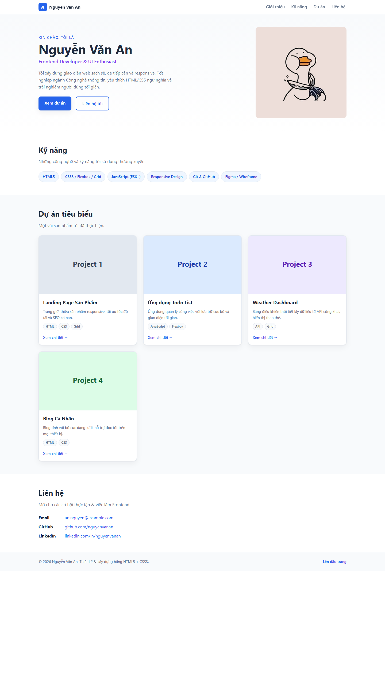
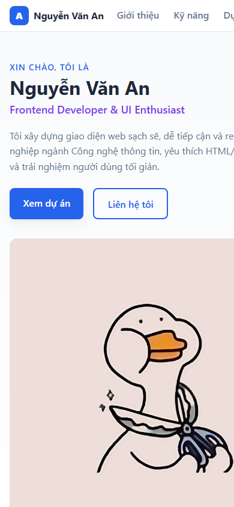

# BÁO CÁO KIỂM THỬ

## 1. Thông tin chung

| Hạng mục | Chi tiết |
|---|---|
| Dự án | Portfolio CV - Nguyễn Văn An |
| Phiên bản | v1.0 |
| Ngày kiểm thử | 27/10/2026 |
| Phạm vi | Trang tĩnh `index.html` và stylesheet `assets/css/styles.css` |
| Môi trường | Google Chrome trên Windows; mở trang từ tệp cục bộ |
| Công cụ và phương pháp | Kiểm tra trực quan, kiểm tra DOM và liên kết điều hướng trên trình duyệt, kiểm tra bố cục ở nhiều chiều rộng màn hình |

Đây là kiểm thử thủ công và kiểm tra trên trình duyệt. Dự án hiện không có bộ kiểm thử tự động, cấu hình lint, backend hay quy trình build. Vì vậy, báo cáo không xem các hạng mục chưa được chạy hoặc triển khai là đã xác minh.

## 2. Tổng quan kết quả

| Tiêu chí | Kết quả |
|---|---|
| Tính đúng đắn | Đạt có điều kiện |
| UI/UX | Đạt trong các kích thước đã kiểm tra |
| Khả năng vận hành - xử lý lỗi | Đạt trong phạm vi trang tĩnh; chưa kiểm thử tình huống lỗi chuyên biệt |
| Bảo mật | Đạt qua rà soát cơ bản; chưa phải kiểm toán bảo mật |
| Chất lượng mã nguồn | Đạt cơ bản; chưa chạy công cụ phân tích tự động |
| Khả năng triển khai | Sẵn sàng triển khai dạng website tĩnh; chưa triển khai lên môi trường hosting |

## 3. Kết quả chi tiết

### 3.1. Tính đúng đắn — Đạt có điều kiện

- Trang tải được trong Chrome và có tiêu đề `Nguyễn Văn An · Frontend Developer`.
- Hiển thị đủ bốn khu vực chính: Giới thiệu, Kỹ năng, Dự án và Liên hệ.
- Hiển thị đủ bốn thẻ dự án và ảnh đại diện; trong lần chạy kiểm tra, trình duyệt không ghi nhận ảnh bị lỗi tải.
- Đã bấm liên kết điều hướng “Dự án”; trình duyệt chuyển đến `#projects` và đưa khu vực dự án vào vùng nhìn thấy.
- **Điều kiện/hạn chế:** liên kết “Xem chi tiết” và liên kết GitHub, LinkedIn hiện dùng `href="#"`, chưa điều hướng đến trang đích thật. Email hiện là địa chỉ mẫu.

### 3.2. UI/UX — Đạt trong các kích thước đã kiểm tra

- Giao diện desktop hiển thị rõ phần giới thiệu, kỹ năng, dự án, liên hệ và chân trang.
- Kiểm tra bố cục ở các chiều rộng trình duyệt khoảng 360 px, 885 px và 1425 px: lưới dự án lần lượt hiển thị 1, 2 và 3 cột theo breakpoint CSS.
- Tại các kích thước trên, không phát hiện trang bị tràn chiều ngang; các liên kết điều hướng vẫn nằm trong vùng nhìn thấy.
- Có trạng thái focus dễ nhận biết bằng bàn phím và hỗ trợ tùy chọn giảm chuyển động trong CSS.
- Ảnh chụp màn hình minh chứng được lưu trong [`docs/screenshots/`](screenshots/).

### 3.3. Khả năng vận hành - xử lý lỗi — Đạt trong phạm vi trang tĩnh

- Trang mở và hiển thị nội dung khi chạy trực tiếp từ tệp cục bộ.
- Các liên kết neo chính hoạt động trong lần kiểm tra thủ công.
- Ảnh đại diện và ảnh minh họa dự án tải được trong lần kiểm tra.
- Trang không có JavaScript, biểu mẫu gửi dữ liệu, API hoặc thao tác ghi dữ liệu nên không có luồng nghiệp vụ động để kiểm thử xử lý lỗi.
- Chưa kiểm thử các tình huống như thiếu tệp ảnh, trình duyệt ngoại tuyến hoặc lỗi máy chủ. Hiện không có giao diện dự phòng chuyên biệt cho các tình huống này.

### 3.4. Bảo mật — Đạt qua rà soát cơ bản

- Phạm vi hiện tại là trang tĩnh, không có backend, xác thực, cơ sở dữ liệu, biểu mẫu nhập liệu hoặc bí mật cấu hình trong mã nguồn được kiểm tra.
- Không có JavaScript xử lý dữ liệu người dùng trong phiên bản hiện tại.
- Đây chỉ là rà soát cơ bản trên mã nguồn và chức năng hiện có; **không** bao gồm quét lỗ hổng tự động, kiểm thử xâm nhập, kiểm tra cấu hình hosting hoặc đánh giá dịch vụ bên thứ ba.

### 3.5. Chất lượng mã nguồn — Đạt cơ bản

- Tách cấu trúc HTML và stylesheet CSS; sử dụng các phần tử HTML có ý nghĩa như `header`, `nav`, `main`, `section` và `footer`.
- CSS tổ chức theo khu vực giao diện, có breakpoint responsive và quy tắc `prefers-reduced-motion`.
- Ảnh nội dung có văn bản thay thế (`alt`).
- Chưa chạy HTML validator, CSS linter, kiểm thử tự động hoặc công cụ phân tích chất lượng mã.
- Các liên kết placeholder `href="#"` và nội dung giới thiệu dự án mẫu cần được thay bằng liên kết/nội dung thực tế trước khi phát hành chính thức.

### 3.6. Khả năng triển khai — Sẵn sàng có điều kiện

- Đây là website tĩnh, không cần cài dependency, backend hay bước build; có thể triển khai lên dịch vụ lưu trữ website tĩnh.
- CSS và ảnh được tham chiếu bằng đường dẫn tương đối trong dự án.
- Đã xác nhận trang hoạt động từ tệp cục bộ; **chưa** triển khai hoặc kiểm tra website trên hosting, tên miền, HTTPS hay quy trình CI/CD.
- Trước khi phát hành, cần cập nhật thông tin liên hệ và các liên kết mẫu.

## 4. Hạn chế và đề xuất

1. Thay các liên kết `#` của dự án, GitHub và LinkedIn bằng URL đích hợp lệ.
2. Thay email và nội dung minh họa bằng thông tin đã được xác nhận.
3. Nếu bổ sung biểu mẫu, API hoặc JavaScript, cần thêm kiểm thử cho dữ liệu đầu vào, lỗi mạng và trạng thái lỗi của giao diện.
4. Trước khi phát hành, chạy validator/linter và kiểm tra trang sau khi triển khai trên hosting thực tế.

## 5. Minh chứng hình ảnh

Các ảnh dưới đây được chụp khi kiểm tra giao diện và lưu trong `docs/screenshots/`.

### Desktop — 1440 × 2600

### Mobile — 390 × 844

