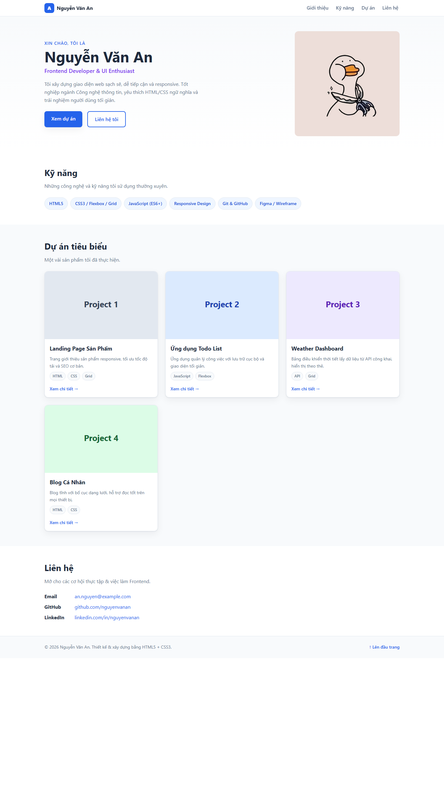
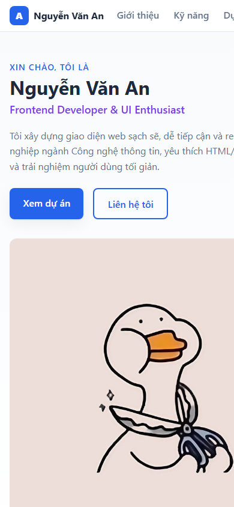

# Báo cáo kiểm thử

## 1. Thông tin chung

| Hạng mục | Chi tiết |
|---|---|
| Dự án | Portfolio cá nhân — Hoàng Diệu Chiêm |
| Ngày cập nhật báo cáo | 03/11/2026 |
| Phạm vi | `index.html`, `Login.html` và tài nguyên trong `assets/img/` |
| Công nghệ | HTML, CSS và JavaScript nhúng trong các trang |
| Môi trường kiểm tra | Google Chrome trên Windows, mở trang từ tệp cục bộ |
| Phương pháp | Kiểm tra DOM và giao diện trên trình duyệt, điều hướng menu, rà soát mã nguồn |

Đây là báo cáo kiểm tra thủ công. Dự án không có bộ kiểm thử tự động, cấu hình lint hoặc quy trình build; các hạng mục đó chưa được xác minh.

## 2. Kết quả

| Hạng mục | Kết quả |
|---|---|
| Hiển thị trang | Đạt trong lần kiểm tra trên trình duyệt |
| Điều hướng | Đạt với menu điều hướng và liên kết tới khu vực liên hệ |
| Giao diện responsive | Có quy tắc responsive; chưa kiểm thử đầy đủ trên nhiều thiết bị/kích thước |
| Biểu mẫu liên hệ | Có kiểm tra bắt buộc phía trình duyệt và thông báo xác nhận phía client; chưa gửi hoặc lưu dữ liệu |
| Đăng nhập | Chỉ là luồng demo dựa trên `sessionStorage`, không phải xác thực bảo mật |
| Kiểm thử tự động/triển khai hosting | Chưa thực hiện |

## 3. Phạm vi giao diện đã rà soát

- Trang chủ và phần giới thiệu.
- Ba thẻ kỹ năng: HTML, CSS và JavaScript.
- Ba thẻ lĩnh vực công việc và ba thẻ dự án mẫu.
- Phần liên hệ với các trường email, số điện thoại và địa chỉ.
- Các thay đổi giao diện gần đây: chữ mô tả trong các thẻ chuyển sang trắng; nhãn và phần mô tả liên hệ chuyển sang hồng; đoạn giới thiệu chính dùng xanh dương đậm.

Trong trình duyệt, trang hiển thị tiêu đề `Modern Glow | Portfolio`; menu trên màn hình nhỏ mở được và liên kết Contact đưa tới phần liên hệ. Nội dung biểu mẫu được hiển thị. Việc gửi biểu mẫu, đăng nhập/đăng xuất, tải ảnh khi thiếu tệp và lỗi mạng chưa được kiểm thử trực tiếp trong lần rà soát này.

## 4. Giới hạn và lưu ý

- Biểu mẫu chỉ hiện thông báo tại trình duyệt rồi xóa các trường; không gửi thông tin đến máy chủ và không lưu dữ liệu.
- Trang đăng nhập chỉ đặt giá trị demo trong `sessionStorage`; không sử dụng để bảo vệ dữ liệu hoặc xác thực người dùng thật.
- Nội dung portfolio, dự án, email và liên kết mạng xã hội cần được xác nhận/cập nhật trước khi phát hành.
- Cần kiểm tra trực tiếp trên các kích thước desktop và điện thoại, chạy trình xác thực HTML/CSS và thử sau khi triển khai lên hosting trước khi xem là đã sẵn sàng phát hành.
- Các ảnh trong `docs/screenshots/` là ảnh minh họa đã có sẵn; chưa được chụp lại trong lần cập nhật báo cáo này.

## 5. Minh chứng giao diện

### Desktop

### Mobile

